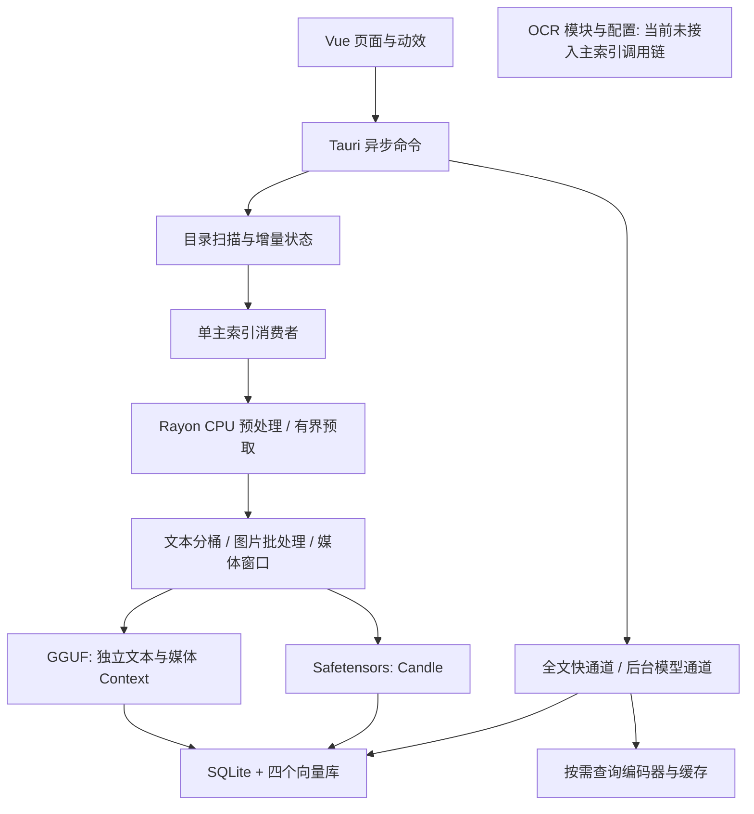

# DeepDark_Oracle 开发交接文档

> 整理日期：2026-11-15。范围：近期索引、检索、模型、界面、扩展与构建工作，同时保留理解当前设计所需的前期背景。
>
> 本文按当前实际代码核对，不把历史需求、已有接口或此前回复中的“已完成”直接当成当前能力。与旧版 `HANDOFF.md`、README 冲突时，先以本文的审计结论和当前代码为准。

## 1. 接手先看这些

| 项目 | 当前状态 |
| --- | --- |
| 软件 | Windows 本地文件检索工具，当前应用名 `DeepDark_Oracle`；历史名 deepaisee |
| 版本 | `package.json`、`Cargo.toml` 等仍为 `0.0.28`；版本号不足以判断是否包含最新修复 |
| 工作目录 | `E:\项目\AI--deepaisee` |
| 本次审计的代码基线 | `f5f3839`，2026-11-15，“文档检索功能优化” |
| 技术栈 | Vue 3 / TypeScript / Vite 6 + Tauri 2 + Rust + SQLite FTS5 + llama.cpp/mtmd + Candle |
| 模型分发原则 | 只提供工具与模型接入能力，不捆绑 GGUF、safetensors 或 OCR 权重 |
| 最近修复 | 扩展安装互相禁用、缺少 pip、视频低相关误召回、检索死锁、模型切换、旧索引兼容、PDF 文字提取等 |
| 最近安装包 | 2026-11-09 构建，未包含 11 月 15 日修复；详见第 10 节 |
| 当前最重要缺口 | **索引主流程没有接通 OCR，也没有生成新的文档页级/图片页级向量**；分页全文检索及旧页向量的读取接口存在 |

接手时先确认运行的 exe、实际数据目录、使用的模型、编入的后端、向量维度与编码器身份。不要用“都是 768 维”判断两个索引能否混用，也不要先删除索引排查问题。

## 2. 近期工作汇总

### 2.1 搜索界面与响应速度

- 搜索主体保留胶囊输入框，工作区位于其上方半圆角区域；背景透明，显示上边框和向下渐隐的侧边，不显示独立下横线。移除最近文件下拉框及左上角搜索耗时毫秒数。
- 搜索范围支持仅索引、全盘、盘符及保存的目录；工作区的路径、最近记录和启动范围由主页相关逻辑维护。通用设置不再重复放一套工作区管理。
- 搜索通道为全文、语义、图像、音频，可多选，默认选中四类。文件类别将文本并入文档，并保留其他类别。
- 先展示首批 500 条，后台继续分页取得结果；滚动再挂载后续卡片，避免一次把全部缩略图放进响应式界面。保留全量选择、等待后台加载后导出的设计。
- 类型切换主要过滤已收集的结果；同一查询下复用已加载结果及 PDF 缩略图缓存，减少重新检索、解码和渲染。
- 全文先返回；模型通道在后台按语义、图像、音频依次执行。每完成一个通道就合并显示，不等待全部模型任务完成才出首屏。
- 新查询使用 generation 标识淘汰旧响应，旧任务不能覆盖新搜索；尚未开始的旧模型通道不再继续唤醒。
- 思维图采用异步加载，等待检索、分页和后台通道空闲后才取数据；有独立的过期响应检查，组件销毁时清理定时器。此前引入的变量初始化顺序错误也已修复。
- Tauri 的搜索、语义搜索、相似检索转移到后台阻塞任务，避免数据库或原生推理占住前台 IPC 调度线程。

这些是减少阻塞和重复工作的工程改动，不代表已证明任何规模下都能做到“无感”或固定毫秒响应。

### 2.2 检索正确性

- 修复指定索引目录/文件类型后全文结果消失：从通过范围筛选的文件行建立映射，不再从空候选表查找 FTS 命中。
- 修复冷启动语义检索和过期搜索缓存重复加锁造成的死锁。
- 查询向量按模型身份与查询词缓存；同一个冷查询的多个请求共享一次编码，避免语义、图像、音频通道重复执行主模型前向计算。
- 主模型、CLIP/CLAP 查询在模型生命周期锁下复核运行时，避免恰好被空闲卸载后漏掉结果；模型推理期间不长期持有 AppState 模型 RwLock。
- 全文采用页级证据，避免把不同页面上的两个词拼成一次“完整匹配”。
- 对“发动机活塞”等组合查询，提高同一页/窗口内的词覆盖要求；只有“活塞”的其他系统文档不再因此成为强全文匹配。
- 完整连续短语全文命中得 1.0；非完整短语的多词共现降为中等证据，再由语义通道帮助排序。
- 修复“猫猫”等任何关键词都出现相同五个汽车视频：视频原先因有时间映射而绕过普通门槛，0.66–0.67 的弱相关也会显示。现取消该豁免，且覆盖语义、图像、音频及混合通道。
- 过滤过期、缺少数据库映射的合成向量 ID；视频与 PDF 图片查询尽量按空间、维度、模型身份选择有效向量，避免旧模型记录占据候选。

### 2.3 索引流水线与资源管理

- 采用单主索引消费者 + CPU 预处理池 + 有界队列。移除旧“狂暴/多模型实例数量”产品策略，改为节能、自动和专业自定义 CPU 线程数。
- 图片读取、解码、缩略图、视觉标签及 CLIP 像素准备移到 CPU 生产者；模型消费者直接拿已准备的输入。
- 文本按长度分桶；PDF 文本和 PDF 图片分别批编码；独立图片与 PDF 图有不同 token 预算。
- 图片动态批次有上限 64，实际通常受设备显存、注意力预算、配置和后端能力进一步限制；并非每次都能处理 64 张。
- 视频和长音频逐窗口解码，预取与模型计算重叠；视频主路径保留逐窗口向量及时间范围，而不是仅保存整文件向量。
- 批量失败优先递归拆分；能力不支持与真正模型错误分开处理。OOM 的单项不再反复用同样输入重试。
- SQLite 的状态确认、文档页写入及部分视频窗口保存采用事务批量提交；向量检查点后再确认完成状态。
- 取消检查覆盖队列、批次间、FFmpeg 子进程及部分提取路径；取消时保存已完成工作，不把未处理文件计入完成。
- 停用/切换模型先取消旧任务、等待消费者退出和检查点，再释放旧上下文、加载新运行时；操作放后台，避免前台直接等待原生资源释放。
- 完成计数和耗时在运行时重建、按需重载时保留，下一次新任务才重置。索引完成后的模型保温约 10 秒，再在仍空闲时释放重资源。
- 建立索引期间提升进程优先级，结束/停止后恢复。优先级不能消除解码、模型串行或磁盘瓶颈。

### 2.4 文档提取与预览

- 支持 PDF、DOCX、PPTX、表格及常见文本/代码抽取；旧 `.doc` 使用程序化解析路径，不是调用 Word 打印。
- PDF 文字层预检改为解析内容操作符，支持紧贴字符串的 `Tj/TJ`、Form XObject 及合法引号文本操作符，降低有正文却误判为空的情况。
- 对明确的 `GBK-EUC-H` 中文字体提供严格解码兜底，保留空页位置；不对任意乱码做无依据编码猜测。
- 旧版误判空正文的 PDF 有一次性增量迁移标记 `pdf_text_preflight_version=1`；更新后普通增量索引可补处理，无需清空整个数据库。
- PDF 预览随窗口尺寸变化，每一页按自己的宽度缩放；同文件混合横页、竖页也尽量铺满宽度。
- PDF.js 的 CMaps 和标准字体同时供应开发服务与生产构建，修复部分中文文档预览没有文字的问题；有 worker 失败后的受控回退。
- 结果优先使用返回的命中页显示缩略图与预览。**前端能显示页码不等于当前索引已生成页向量，详见第 4 节。**
- 修复缩略图与实际文件身份不一致、资源管理器打开位置等问题；卡片与预览使用文件路径、ID、页码信息定位。
- 卡片悬停 1.5 秒出现动态预览，无标题栏/滚动条，底部页码，滚轮翻页。离开卡片有约 260 ms 的移入预览缓冲，移出预览后立即关闭；不能写成所有离开动作都无延迟。
- 评分禁止文字选中和双击冒泡；双击卡片仍打开原文件，右键保留定位、重命名和复制等操作。评分颜色为至少 0.75 绿、至少 0.45 橙、其他深红，当前查询门槛下低分区通常不会出现。

### 2.5 设置、模型与扩展

- 设置恢复为七个标签：通用配置、文件索引、模型配置、图形与 GPU、可选扩展、局域网配置、日志。
- 通用配置自动保存，移除重复工作区模块及“启动扫描是增量的……”说明和通用保存按钮。专业索引参数仍有自己的保存/下次生效机制。
- GPU 选择从模型配置移到图形与 GPU，按后端检测结果显示设备按钮；一次选择一个主推理设备。Vulkan 可枚举部分核显/AMD，不能据此宣称已实现多 GPU 协同。
- 模型区显示文本、图片、音频、视频、OCR 五种能力；推理模型和 OCR 模型角色分开，支持单独停用；配套 projector 用多模态标签归属主模型。
- 模型列表前端缓存并后台检查新增/删除，避免每次进入都清空重载；OCR 状态探测有缓存，外部探测进程隐藏窗口。
- 专业索引参数整理成索引库与正文、图片、视频与音频、文件范围四组，更多字段改成预设选项，同时保留旧自定义值。
- 可选扩展两列布局，提供 ONNX Runtime、Python sidecar、PyTorch 的按需安装，安装包不默认携带。
- 修复扩展共用一个安装状态导致所有按钮被禁用：每项独立 busy，成功/失败独立恢复，响应按字段合并，避免并发返回覆盖其他扩展状态。
- 安装、更新、删除放后台；ONNX 与 Python 可并行。Python/PyTorch 共享同一环境，其文件修改在后台依次执行，但用户可提交两个请求。
- 修复 embedded Python 已存在却没有 pip：安装 PyTorch 前修复 `_pth`、`Lib\site-packages` 和 `import site`，缺 pip 时自动 bootstrap。
- 日志增加按文件着色的耗时分布条、展开后的文件/阶段耗时及最慢文件。它是近期日志的耗时汇总，不是覆盖整个任务的精确实时百分比。

## 3. 当前架构与真实并发边界



- GGUF 已有 `text_handle` 与 `media_handle`，各自独立 Mutex 和 `llama_context`。C++ 通过引用计数共享只读 `llama_model` 权重，文本 context 不挂 mtmd。
- C++ 的全局创建锁只保护模型创建，不是把所有推理锁在一把全局锁上。
- **双 context 不等于所有文件跨模态并行**：当前主消费者按同类任务组批；PDF 的文本 lane 与图片 lane仍顺序执行，视频/音频通常逐文件逐窗口消费。长任务仍可能推迟后面其他类型的文件。
- Candle 使用自己的模型锁；不能套用 GGUF 的两个独立 context 解释它的执行并发。
- 文本 multi-sequence batching、图像 batch API、媒体内多帧混排是不同机制，不能都当成跨文件的大张量批处理。mtmd 视觉预处理/编码仍可能串行，实际吞吐要测。
- 目前没有把一个索引任务拆到独显、核显同时推理；主 GPU 只有一个。NVDEC 是支持时的视频硬解，属于解码卸载，不等于多 GPU 模型协同。
- 新增加文本实例未必提速：当 GPU 计算已饱和时，额外实例可能增加争用。应先看 CPU 预取、真实 batch、解码、数据库与模型耗时。

## 4. 各类文件目前究竟如何处理

### 4.1 文本、代码与普通文档

1. 扫描把路径、大小、修改时间、类型等写入 `files`，增量选取新增/变化/失败待重试项。
2. CPU 池抽取正文，或复用已有正文；写 `docs`，并通过 `Db::set_doc` 写入 `doc_pages` 与页级 FTS `page_docs`。
3. 有物理分页符的格式保留分页；无分页的长文本按稳定逻辑块切分。因此“页码”需要区分物理页、幻灯片号和逻辑块号。
4. 向量主路径把单文件正文交给 `embed_text_batch` 等接口；长正文在 GGUF/Candle 适配器中切块，块向量按输入文件均值融合并 L2 归一化，而不是把无限正文一次送入模型。**当前最终按文件 ID 保存文件级向量，并未逐页/逐块持久化新向量。**
5. DOCX 只有显式分页标记才能还原部分真实分页，不能保证等于 Word 排版页码；PPTX 可按 slide 提取分页全文。Excel 内容可检索，不应称为拥有稳定打印页码。
6. 旧 DOC 的解析已减少逐字符重复扫描等开销，但复杂对象、嵌入内容和老编码仍可能慢或提取不全。此前指定的大 DOC/DOCX 需要保留作性能回归样本。

### 4.2 PDF

当前主入口为 `Indexer::process_pdf_batch`：

1. 多 PDF 在 CPU 池并行提取全文，支持复用已有 raw；有文字层直接程序解析，不需要 AI。
2. 调用 `pdf_images_with_cancel(path, 4, ...)`。这里的 4 是最多选择的有图物理页数，**不是全文件只抽 4 张，也不是每一页都覆盖**。
3. 提取器先找连续至少三页同宽高的图片，作为疑似重复标识/水印过滤；再按面积选图，每选中页最多 4 张，最长边 512 像素。对无法直接解码的合适候选页有有限整页渲染回退。
4. 嵌图采样最多为 4 个有图页 × 每页 4 张；另有最多 4 页的受限整页渲染回退，不能把总输出硬解释为最多 16 张。尺寸去重只是启发式，可能误过滤相同尺寸的不同内容；512 像素缩放发生在嵌图解码后。
5. 图片原本的页码没有一路传到主向量写入端。全文文本与图片分别批编码，最后均值融合并归一化，写成该 PDF 的一个文件级主向量。
6. 可选 CLIP 也有文件级代表图融合路径。新索引目前不写 `doc_image_vectors`，因此不能保证从新 PDF 索引精确定位某张内嵌图。
7. 全文的页级 FTS 可以返回命中页；语义检索也能读取旧库已存在的页向量映射，但这不能证明新建流程具备分页向量。

**结论：此前“一页一个向量”“五页一个向量并保存内部页分布”“基础向量先落盘、OCR 后台补页向量”等说法不能描述当前活跃代码。分页向量、OCR 接入均是后续优先补齐项。**

### 4.3 独立图片

- CPU 并行打开图片、生成缩略图/简单视觉标签，并提前生成可选 CLIP 像素输入；解码结果通过容量有限的队列交给模型。
- 主模型有视觉能力则进入主共享向量空间；否则尝试媒体空间。Hash fallback 仅为确定性特征，不具有真实跨模态语义理解。
- 主模型图片批次上限 64，实际按可用显存和后端预算缩小；配置的目标 batch 不是硬承诺。
- 如有 CLIP，再写入独立 CLIP 空间。普通图片当前不会自动送入 OCR；另一方面，当前扫描 PDF 也尚未在主流程调用 OCR，不能把“不处理普通图片”误写成“OCR 已正确分流完成”。
- 默认独立图片 soft-token 预算 1120。token 数和缩放后的像素大小是两项不同设置。

### 4.4 音频

- FFmpeg 解码为 16 kHz 单声道 PCM；原生音频编码路径将长音频切为不超过 30 秒的窗口，做前后窗口解码预取。
- 原生模型支持音频时编码窗口；可选 CLAP 是另一套独立模型与空间。
- 当前普通音频最终主要聚合为文件级结果，不等同于视频已经持久化的逐窗口定位能力；不能承诺每一段语音均可精确跳秒。
- 音频 embedding 不是 ASR。没有转写文本时，不能保证任意人说的一句话都能像全文一样命中；目前没有通用的自动语音转写链路。

### 4.5 视频

1. 探测时长和流信息；按最长 30 秒窗口规划，模型实际上下文不足时自动缩短，末段保留实际长度。
2. 对每个窗口用 FFmpeg 的 seek/时长限制读取对应画面与音轨，并非必须先输出一套永久的 30 秒 MP4 文件。
3. 原生视频路径目标每秒 1 帧、每帧默认 140 tokens，同窗口音轨为 16 kHz 单声道。若上下文 8192，30 帧约 4200 tokens，加 30 秒音频约 750 tokens，另需预留文本/特殊 token。
4. 支持时优先尝试 CUDA/NVDEC 硬解，失败时回退软件解码；不能保证所有编码器、驱动、FFmpeg 构建都会启用硬解。
5. 有界预取准备后续窗口，减少模型等 FFmpeg；媒体编码依旧通常逐窗口进行，不是把不同视频的所有窗口混成一个 GPU 大 batch。
6. 提取同目录同名字幕（如 SRT/VTT/ASS）及可抽取的内嵌文本字幕，保留 cue 时间；位图字幕与画面上烧录的文字不等于已被读取。
7. 支持原生混排时生成窗口联合向量；能力受限时存在视觉帧向量平均、字幕文本等替代路径。没有输入过模型的音轨或画面无法被检索。
8. `video_segments` 保存 `vector_id/file_id/segment_no/start_ms/end_ms/subtitle/embedding/vector_space/vector_dim/model_key` 等信息，可按完成窗口续建/恢复，部分写入使用批事务。
9. 检索优先显示字幕中真正匹配的 cue；没有字幕时只能显示窗口时间范围，例如 `00:00–00:30`，一个 pooled 向量不能反推出哪个精确帧出现目标。
10. 可选 CLIP/CLAP 文件级补充向量与原生窗口向量并存。CLIP 的场景/I 帧/去重采样不是原生窗口 1 FPS 规则，两套参数不要混淆。

实际问题样本：五个汽车视频共 37 个当前 GGUF/768 维窗口，全部无字幕；未发现 Hash 或模型空间混用，首段之间相似度很高。此次修复的是弱视频的检索放行规则，并没有重新生成它们的向量。

### 4.6 OCR 的真实状态

- `ocr.rs`、`teleocr_worker.py` 已包含运行时探测、模型目录发现、Tesseract/TeleOCR 调用接口、子进程隐藏、取消与超时、部分回退能力。
- 未配置 OCR 模型时接口设计优先轻量 Tesseract；配置 TeleOCR 时需要可用 Python 及其推理依赖。Tesseract 还需自身可执行程序、语言包及 PDF 渲染器（如 pdftoppm/mutool），不是安装 PyTorch 就具备全部 OCR。
- 模型配置能够显示 OCR 能力与缺少依赖，扩展可安装运行环境。
- **当前 Indexer 仅保存 `_ocr: OcrConfig`，活跃索引调用链没有调用提取 OCR 的接口。** 因此目前不能承诺扫描件会自动 OCR、与主推理并行或后台增量补正文。
- 后续应先接通“低文字量扫描 PDF 页 → 有界 OCR 队列 → 先写正文 FTS → 可选增量页向量”的闭环，再讨论增加 OCR batch 或 GPU 利用率。不要重新把所有图片默认送 OCR。

## 5. 检索流程与相似度规则

### 5.1 什么时候需要 AI

| 操作 | 是否需要模型推理 |
| --- | --- |
| 文件名/正文/字幕全文、普通范围/类型筛选 | 不需要主 AI；SQLite/程序逻辑完成 |
| 语义搜索 | 需要把查询词编码成向量；命中缓存可省重复编码，模型可能按需加载 |
| 文字找图片/声音 | 需要兼容共享多模态编码器或 CLIP/CLAP 的查询编码 |
| 已有查询向量与库内向量比较 | 当前在 CPU 侧做余弦扫描，不需要重新推理每个文件 |
| 默认四通道全选的主页搜索 | 全文先出，但后台仍可能唤醒模型；不能称为全程 0% AI |

EmbeddingGemma 的跨语言能力是共享语义空间匹配，不是自动翻译。项目已按用户要求移除多语言翻译设置，不应再用“自动翻译”解释中文查询英文内容。

### 5.2 当前分数含义

相似度是排序证据，不是“有多少概率相关”。各通道量纲和映射不同。

| 证据 | 当前规则 |
| --- | --- |
| 完整连续短语全文命中 | 1.0，允许规范化空白后的短语对齐；仍须在同一页/窗口内成立 |
| 多词非短语全文 | 需覆盖至少 `max(2, 词项数-1)` 个词项，否则不显示；分数上限 0.70 |
| 普通语义原始余弦门槛 | 至少 `max(配置 semantic_floor, 0.68)` |
| 1–2 字符查询的语义门槛 | 至少 0.76，更高用户阈值仍有效；这是字符数规则，不限中文 |
| 视频共享向量 | 所有主向量通道使用普通语义门槛；时间戳不再构成豁免 |
| 语义显示分数 | 不是完全原样显示余弦：≤0.70 保留；0.70–0.85 映射到 0.70–0.90；0.85–1 映射到 0.90–0.99 |
| 共享空间图片 | 使用另一个跨模态门槛及 0.68–0.96 映射；实际图片调用门槛至少约 0.45，不能照搬文本阈值解释 |
| 独立 CLIP/CLAP | 各有 floor、峰值/中位数等通道判断和分数映射，不能与主模型原始余弦直接比较 |
| 最终非空查询显示线 | 0.68；空查询浏览另有逻辑；NaN/无穷语义分数被拒绝 |

同一文件多通道合并通常按全文 ＞ 语义 ＞ 图像 ＞ 音频解释，但有明确例外：非精确全文与语义同时命中时，前端按全文 25% + 语义 75% 融合并使用语义标签。精确全文仍优先，避免“发动机活塞”被单个歧义词抢占前列。

### 5.3 性能边界

- 查询向量缓存有编码器/配置身份参与；不同模型不能共用同一份缓存。
- 查询向量缓存最多 256 个键，有 single-flight 共享冷编码；完整检索结果缓存约 3 秒、最多 64 个键。模型列表约 30 秒节流检查，OCR 状态约 20 秒缓存；这些是不同用途，不能统称“模型已一直加载”。
- 文件来源、页码、视频元数据及 snippets 尽量批量读取，避免每条结果一次 SQLite 查询。
- 向量库是常驻内存的 flat f32 存储，按余弦精确扫描并选 top-k，规模较大时利用 Rayon；**尚未接入 HNSW/ANN**。
- 后端仍有 50,000 级安全上限，部分带过滤的候选扫描限制更小。前端后台分页不等于真正无限结果；“全选全部”仍受后端候选边界约束。
- 首次纯语义查询可能支付模型加载成本；索引后短暂保温只减少一部分冷启动，不是所有场景的永久常驻。
- 图谱延后执行减少前台争用，但 CPU 精确向量扫描、模型查询和缩略图解码仍有共享硬件成本。

## 6. 模型、GPU 与参数约定

### 6.1 模型接入

- GGUF → `ai/llama.rs` → `native/llama_shim.cpp` → llama.cpp/mtmd。
- Safetensors → `ai/candle_backend.rs` → 仓库内 `vendor/embeddinggemma-2-candle`。
- 多模态 GGUF 需要架构兼容的 `mmproj` 和实际编译支持，放文件到目录里本身不会产生视觉/音频能力。
- 模型导入检查 config、tokenizer、单权重/分片索引及所有 shard；支持部分自定义 safetensors 文件名。缺文件与后端不支持是两类错误，应区分。
- safetensors/GGUF 只是容器，不代表任意架构可运行。Qwen/Jina 等新模型需要核对 tokenizer、模型实现、模态、pooling、维度和输入协议，不能承诺无需适配。
- ONNX Runtime 不能直接加载 safetensors/GGUF；PyTorch 安装不会给 Rust Candle 补上 CUDA feature，也不会自动使任意 OCR 模型受支持。
- 启动默认不自动加载主模型；明确索引/语义任务再按配置或上次模型按需加载。停用不是把已有全文索引一起删除。

### 6.2 常用默认值

| 配置 | 当前默认/约定 |
| --- | --- |
| `index.vector_dim` | 768；专业模式提供 768 / 512 / 256 |
| `model.context_size` | 8192；受模型训练窗口和实际后端限制，不是任意无限上下文 |
| 独立图片预算 | 1120 soft tokens |
| PDF 图片预算 | 280 soft tokens |
| 视频每帧预算 | 140 soft tokens |
| 原生视频采样 | 1 FPS，窗口最长 30 秒，上下文不足则缩短 |
| 音频输入 | 单声道 16 kHz；常见窗口上限 30 秒 |
| `index.max_text_chars` | 200,000；这是抽取字符数，不等于模型能一次看完的 tokens |
| `index.batch_size` | 默认目标 8，设备及任务动态调整 |
| 节能 CPU 策略 | 约逻辑线程数的三分之一，代码向上取整，受当前空闲比例限制 |
| 自动 CPU 策略 | 最多逻辑线程数的 90%，受当前 CPU 空闲比例限制 |
| 自定义线程 | 1 到逻辑线程数；当前不按自动策略同样扣除繁忙占用 |

显存批次预算保留至少约 1 GiB 余量并额外采用保守比例；它是批次估算，不是对 Windows 全系统显存占用的硬限额。不能承诺 16 GB 卡任何时候都绝不超过 15 GB。

## 7. 数据库、向量身份与升级兼容

```text
实际 data 目录/
  config.json
  index.db                 SQLite；运行中可能有 -wal / -shm
  thumbs/                  缩略图
  vectors/                 主向量空间
  vectors_media/           媒体向量空间
  vectors_clip/            CLIP 空间
  vectors_audio/           CLAP 空间
```

- `config.rs::data_dir/resolve_data_dir` 检查 exe 同级便携 data、LOCALAPPDATA 和 APPDATA 等候选，优先已有有效索引，减少升级后新空库遮住旧库的问题。
- 本机近期真实 debug 库为 `D:\DeepDark_Oracle-build\target\debug\data\index.db`；仓库根 `data\index.db` 曾只是空壳。不要只看 cwd 下的数据库。
- 目录选择仍是启发式，不是完整迁移协议。若多个目录都有有效数据，需核对日志、配置、库统计和整套向量文件是否配对。
- `files/docs/doc_pages/page_docs` 保存文件与全文；`doc_vector_pages/doc_image_vectors` 保存页向量映射接口；`video_segments` 保存窗口元数据及向量恢复信息；`activity` 保存日志。
- `encoder.json` 保存后端、规范化模型路径、原生维度及相关 model_key。不同编码器即使都是 768 维也不直接混用，GGUF 与 Candle 当前按不同身份处理。
- 切换编码器会归档旧向量到 `previous-models/`，保留正文并把向量标成待重建。维度不匹配时不直接删除用户磁盘向量。
- 身份尚不含权重内容指纹；同一路径替换权重无法可靠自动检测。无身份标记的历史向量是兼容接管，不能证明其历史模型一定正确。
- 降维需要兼容模型/投影并重建对应向量，不是把任意 768 数组直接改宽度就保证语义一致。
- 迁移时先退出软件，再复制完整实际 data；若运行中备份必须正确处理 SQLite WAL。更换文件盘符后还需处理原始绝对路径与扫描根；只复制向量文件不等于完成迁移。
- 这次视频误召回修复仅改查询过滤，无需重建现有视频索引。旧误判空 PDF 则需一次增量补处理。换模型/维度需要重建向量，与这两类情况区分。

## 8. 关键代码入口

| 区域 | 文件与关键入口 |
| --- | --- |
| 启动、命令注册 | `src-tauri/src/lib.rs`、`main.rs` |
| 全局运行时、锁、查询缓存 | `src-tauri/src/state.rs` |
| IPC、扫描/模型切换/扩展安装 | `src-tauri/src/cmd.rs` |
| 扫描与增量状态 | `src-tauri/src/scan.rs`、`config.rs` |
| 活跃索引实现 | **`src-tauri/src/index.rs`**；同目录 `index-6db.rs`、`index-8f.rs`、`.corrupt*`、`.pre-repair` 是历史/诊断副本，不是活跃模块 |
| PDF/Office/文本提取 | `src-tauri/src/textract.rs`、`vendor/pdf-extract/src/lib.rs` |
| 媒体解码、字幕、窗口 | `src-tauri/src/media.rs` |
| OCR 接口与 Python worker | `src-tauri/src/ocr.rs`、`scripts/teleocr_worker.py`；目前待接主索引 |
| 模型抽象、批预算、PDF融合 | `src-tauri/src/ai/mod.rs` |
| GGUF / 原生 C ABI | `src-tauri/src/ai/llama.rs`、`src-tauri/native/llama_shim.cpp` |
| safetensors / Candle | `src-tauri/src/ai/candle_backend.rs`、`vendor/embeddinggemma-2-candle/` |
| 模型发现与缓存 | `src-tauri/src/models.rs`、`src/modelListCache.ts`、`src/views/ModelsView.vue` |
| 检索分数与页/时间定位 | `src-tauri/src/search.rs` |
| SQLite / FTS / 向量 | `src-tauri/src/db.rs`、`vector.rs` |
| 主页、多通道、后台分页 | `src/views/SearchView.vue` |
| 缩略图与预览 | `ResultGallery.vue`、`PdfThumbnail.vue`、`PdfPreview.vue`、`pdfThumbnailCache.ts` |
| 设置、进度、性能日志 | `SettingsDrawer.vue`、`SettingsIndexTab.vue`、`SettingsLogTab.vue`、`src/views/ScanView.vue` |
| GPU / 扩展设置 | `SettingsGpuTab.vue`、`SettingsExtensionTab.vue` |
| 星图与思维图 | `src/galaxy/`、`src/components/MindMap.vue`、`src/views/GalaxyView.vue` |
| 构建与资源 | `scripts/activate-local.ps1`、`tauri.ps1`、`build-release.ps1`、`src-tauri/build.rs`、`tauri.conf.json`、`vite.config.ts` |

前端表格中省略目录的组件文件均在 `src/components/`。

## 9. 接手环境、VS Code 调试与打包

### 9.1 依赖

- 前端按 lockfile 安装，缺少 `3d-force-graph` 等模块先执行 `npm ci`；不要通过 Rollup externalize 掩盖必需依赖丢失。
- Rust 原生构建需要合适 toolchain、CMake/Ninja、Windows SDK；CUDA 构建还需要 MSVC C++ x64、CUDA Toolkit/nvcc 与驱动兼容。
- 脚本通过 vswhere/VS 工具导入 MSVC 环境，配置 NVCC 的 C++ 编译器，通常普通 PowerShell 即可使用。
- Vulkan 构建依赖 Vulkan SDK/头文件/glslc，可由 `.tools/vulkan`、`VULKAN_SDK` 探测，`DEEPAISEE_VULKAN=0/1` 覆盖。
- `vendor/embeddinggemma-2-candle` 和 `vendor/pdf-extract` 是仓库源码；`vendor/llama.cpp` 通常由 bootstrap 获取并打 EmbeddingGemma2 补丁，不在 Git 正常跟踪中。
- 当前 llama.cpp 精确上游 commit 未可靠记录；bootstrap 使用 `b9999`。接手应保留已验证 vendor 源码/补丁并补记版本，不盲目换最新上游。
- `bootstrap-windows.ps1` 是开发机准备脚本，目前会主动安装开发用 ONNX Runtime；这与用户安装包不捆绑 ORT 是两件事。

### 9.2 启动调试

在 VS Code 打开仓库根目录，PowerShell 终端执行：

```powershell
. .\scripts\activate-local.ps1
npm ci
npm run tauri dev
```

首次缺工具时先按项目实际情况执行：

```powershell
powershell -ExecutionPolicy Bypass -File scripts/bootstrap-windows.ps1
```

已有环境不必每次重新 bootstrap 或安装依赖。

- `npm run tauri dev` 经项目 wrapper 自动激活环境；有 nvcc 时通常启用 `llama,candle,candle-cuda`，否则 `llama,candle`。
- 前端服务为 `http://localhost:1420`。仅 `npm run dev` 是浏览器前端，不能完整代替 Tauri 的文件系统、模型和 IPC 能力。
- debug 窗口会打开 DevTools，可检查 Console/Network；前端运行错误不能只靠 Vite build 排除。
- Rust 可使用 rust-analyzer 和 CodeLLDB，附加实际 debug exe 做断点；仓库目前没有成套 `.vscode/launch.json/tasks.json`，不能承诺直接 F5 已配置完成。
- 警惕启动了旧 exe：查看 wrapper 打印的 target 目录，调试数据也通常在该 exe 同级 data，而不是根目录 data。

### 9.3 验证命令

```powershell
npm run build
cargo test --manifest-path src-tauri/Cargo.toml --lib --no-default-features
cargo check --manifest-path src-tauri/Cargo.toml --lib --features candle-cuda
git diff --check
```

后两种 Rust 命令的覆盖不同：无默认 feature 测试验证通用逻辑，不证明 GGUF/CUDA 推理成功；完整后端检查需要原生环境。

真实 GGUF → Candle 切换的测试默认忽略，需要有效本机模型路径后显式运行：

```powershell
$env:DDO_TEST_GGUF_MODEL = '你的 GGUF 模型完整路径'
$env:DDO_TEST_SAFETENSORS_MODEL = '你的完整 safetensors 模型目录'
# 可选：$env:DDO_TEST_GPU_DEVICE = '设备标识'
cargo test --manifest-path src-tauri/Cargo.toml --lib --features candle-cuda native_gguf_to_safetensors_indexes_searches_and_keeps_progress -- --ignored --nocapture --test-threads=1
```

测试使用独立临时数据。不要把真实用户 data 当自动化测试清理目录。

### 9.4 生成安装包

```powershell
npm run tauri:release
```

- 自动执行 Vite 构建、原生后端构建和 NSIS 打包；CUDA feature 随 Toolkit 检测，`custom-protocol` 不可漏，否则发布 exe 可能连接 localhost 开发服务。
- 中文路径下脚本尽量把输出放 ASCII 目录。以日志打印的 `CARGO_TARGET_DIR` 为准，不固定为仓库 `src-tauri/target`。
- 常见输出：`D:\DeepDark_Oracle-build\target\release\bundle\nsis\`，无 D 盘时按脚本回退。
- 可用 `DDO_BUILD_ROOT` 指定构建根目录，已有 `CARGO_TARGET_DIR` 会保留。新机器优先用短 ASCII checkout 路径，减少原生工具链路径问题。
- `activate-local.ps1` 仍有偏 GNU 的镜像检查/警告，甚至可能出现 `rustup\rustup`；该警告不能直接断言 MSVC/CUDA 失败，属于待整理脚本遗留。
- `LNK1104` 无法写 DLL 时核对文件占用、并行构建、路径及安全软件；不要默认是 Rust crate 坏了，更不要直接删全部用户数据。
- 用户运行 CUDA 安装版通常只需兼容显卡驱动与随包运行库，不需要开发用 CUDA Toolkit。4060“未检测硬件”要检查 exe 编入的后端、驱动和 DLL，不能只让用户安装 PyTorch。

## 10. 安装包与源码的对应关系

本次只整理交接文档，没有重新生成安装包。当前实存产物：

| 项目 | 值 |
| --- | --- |
| 文件 | `D:\DeepDark_Oracle-build\target\release\bundle\nsis\DeepDark_Oracle_0.0.28_x64-setup.exe` |
| 修改时间 | 2026-11-09 21:19:05 |
| 大小 | 529,731,437 字节，约 505.19 MiB |
| SHA-256 | `9FD2CA7BBC1050A46EB0DB46D127D6D240B2655CD418B6D98F2BC39757033388` |
| 最新修复 | 不包含 11 月 15 日的源码修复 |

安装资源包括应用、FFmpeg、构建选择的 CUDA/MSVC DLL、三个可选扩展安装脚本等。不应包含用户模型、索引数据库、Python/PyTorch 或 ONNX Runtime。

历史文档中的约 29/32 MB、498/503 MB 安装包尺寸，以及 `C3E...` 等哈希属于别的构建。不能用包名相同或版本同为 0.0.28 推断内容一致。下次发布应记录 commit、后端 feature、时间、大小、哈希和安装版验收结果。

## 11. 已有验证证据与未验证范围

| 验证 | 最近记录与覆盖 |
| --- | --- |
| 通用 Rust 单元测试 | 138/138 通过，命令 `--lib --no-default-features`；含弱视频过滤、四通道/两个空间、时间范围保留、缓存、FTS 等回归 |
| 前端生产构建 | `npm run build` 通过；three chunk 大小仍有提示，图谱采用独立 chunk |
| 补丁格式 | `git diff --check` 通过，只有部分文件换行风格提示 |
| 原生 CUDA 功能检查 | 此前记录 `cargo check --features candle-cuda` 和完整功能测试通过；最新两项修复后未重跑全部 GPU 测试 |
| 真实模型切换 | 此前本机 RTX 4080 的 GGUF → Candle/safetensors 独立测试 1 项通过，20.18 秒；覆盖索引、语义、切换、卸载重载、向量隔离和计数保留 |
| 真实 PDF 文字提取 | 012 PDF：60 页/19,102 字符；183 PDF：62 页/20,881 字符，源文件只读 |
| 真实全文检索 | 独立数据副本搜索“活塞环”可返回 645 PDF 第 12 页、完整词分数 1.0 |
| 扩展前端运行测试 | localhost:1420，1440×1000，已有 Playwright + Edge；模拟延迟 IPC，三项并发可提交，独立成功/失败、状态合并通过，无 Vue/Vite 错误；仅 favicon 404 |
| pip 引导 | 临时 embedded Python 3.12.10 从无 pip 到自动 bootstrap 成功，重复运行成功；未下载完整 PyTorch |

前端证据目录：`C:\Users\bug_fish\AppData\Local\Temp\deepaisee-extension-qa\`，包括 `pytorch-installing-others-enabled.png`、`all-three-installing.png`、`finished.png`。这是模拟安装交互，不等于真实下载链路全部验收。

尚未完成的验收：最新视频过滤后的真实 GPU 关键词相关性评测；扫描 PDF OCR 主流程；新分页向量的生成与检索；最新安装包端到端升级；4060/核显/AMD 目标机完整回归；长媒体及复杂 Office 的统一性能基准。历史“某项测试通过”不能替代这些验收。

本次交接文档整理未重复执行构建或模型测试，以上为近期已记录的验证；本次新增的是源码调用链核对与产物核查。

## 12. 后续优先级与已知风险

### P0：先恢复功能闭环和可验证性

1. **真正接通文档页向量**：从提取结果保留 `file_id + page_no`，分别落 `doc_vector_pages`；PDF 图片需保留来源页/图信息并写 `doc_image_vectors`。明确一页、两页或五页分组，不能只平均成文件向量后声称能恢复页内语义分布。
2. **真正接通扫描 PDF OCR**：限定低文字量扫描页，有界独立队列，基础全文/向量先可用，OCR 输出增量写 FTS 和对应页向量；停用和取消涵盖整个链路。普通独立图片不默认 OCR。
3. 用“猫猫/其他无关词”和“轮胎/动平衡/视频真实内容”共同评测最新视频门槛，既测误召回也测漏召回。不能只测过滤强度，更不能任意拉高显示分数掩盖没有证据。
4. 重新构建最新安装包，做新装、旧数据升级、模型切换与目标显卡验收。当前磁盘旧包不能作为本次交付。

### P1：性能与诊断

1. 为混合类型队列增加公平调度/有限工作量，让长视频不长期占住唯一消费者；在有证据的地方扩大媒体批次或独立准备队列。
2. 当前 PDF 仍先收集一批提取结果再批推理，慢文件可能拖住同批；可改为就绪即消费及逐页流式提交，而非简单增加 GPU 实例。
3. 性能日志需补齐真实模型调用、解码、OCR、数据库、排队、检查点耗时；当前部分 `model` 计时在结果回调附近，不代表完整 GPU 前向时间；另一些文本/图片批次把整个批次模型耗时归到批内每个文件，存在重复归因。
4. 日志 UI 只基于近期约 300 条记录聚合，阶段相加既有并行重叠，也有批次重复归因，不能当作逐文件独占时长或 wall-clock 总时长，也不是全任务实时进度。后续建立 task_id 和结构化 timing 表更可靠。
5. 为大向量库评估 ANN/过滤前置/游标分页，替代越来越多的精确全扫与 top-k offset；明确 50,000 候选上限对全选导出的影响。
6. 视频无字幕时没有细粒度文本证据。需要更细子窗口、关键帧索引、字幕/ASR 或分层重排；仅增加向量维数不能恢复已被平均掉的时间细节。
7. PDF 连续同尺寸图启发式可能误删真实插图，宜增加内容指纹与面积/位置判断；token 预算越高不一定越准，也会增加成本。

### P2：工程整理

1. 固定稳定用户数据目录，提供显式迁移和数据库/向量快照配对检查，减少启发式选错数据。
2. 编码器身份加入权重/tokenizer/projector 指纹；继续审查 legacy 兼容分支，不能只按名称/维度放行。
3. 明确 llama.cpp 精确版本、补丁和可复现构建；整理 GNU/MSVC 共存及 ASCII 镜像逻辑。
4. 模型列表前端虽有缓存，但后端扫描命令仍有同步工作；不要把状态缓存描述成彻底消除了扫描阻塞。
5. 仓库仍跟踪约 72 个 `target-*`/`src-tauri/target-batch-check` 生成文件，另有 `index.rs.corrupt*` 等历史副本及根目录临时诊断文件。需审查后整理版本控制；`.gitignore` 不会自动取消既有跟踪。本次未删除这些文件。
6. 将 README、历史交付说明中的旧尺寸、旧阈值、旧 GPU/工作区入口标为历史，避免下次再次按过期架构开发。

## 13. 接手者的建议执行顺序

1. 记录当前 commit，确认工作树与运行 exe；本次文档新增不会自动进入旧 exe。
2. 找到实际 data，备份整套数据库、配置与向量；确认模型和 projector 可用，记录当前维度/身份。
3. 先跑前端构建和通用单测，再做独立数据的 FTS、语义、图像、音频、视频时间定位与模型切换验证。
4. 优先处理第 12 节 P0，不以已有函数/数据表代替完整调用链验收。
5. 对混合数据建立固定样本集和耗时分段，量化改动效果，再改批量、线程、窗口或 GPU 策略。
6. 用最新源码重新发布并记录产物信息；继续更新本文和 `HANDOFF.md` 当前快照，旧历史保留追溯。

不要通过 `git reset --hard`、`git clean -fd` 或递归删除模型/data/工具链解决环境与索引问题。仓库历史记录、诊断文件、真实用户索引均应先核对用途再处理。
