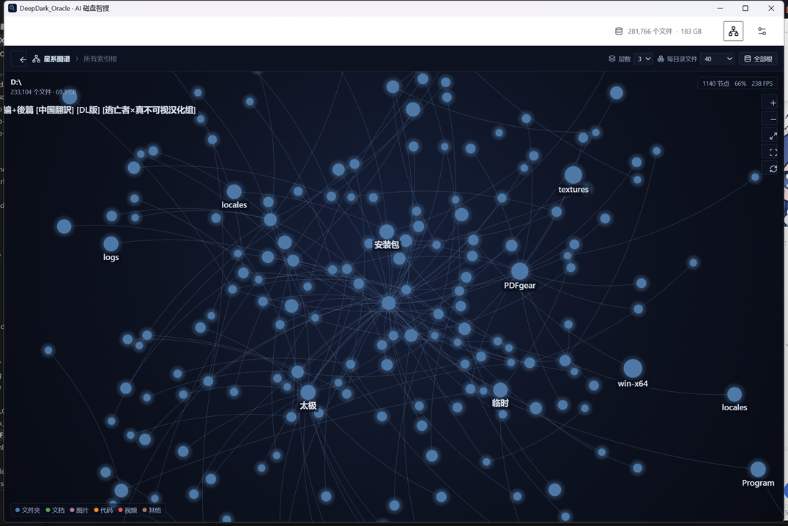
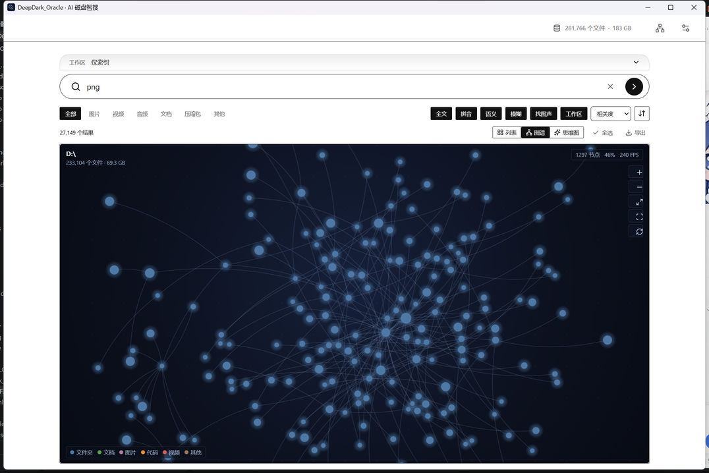
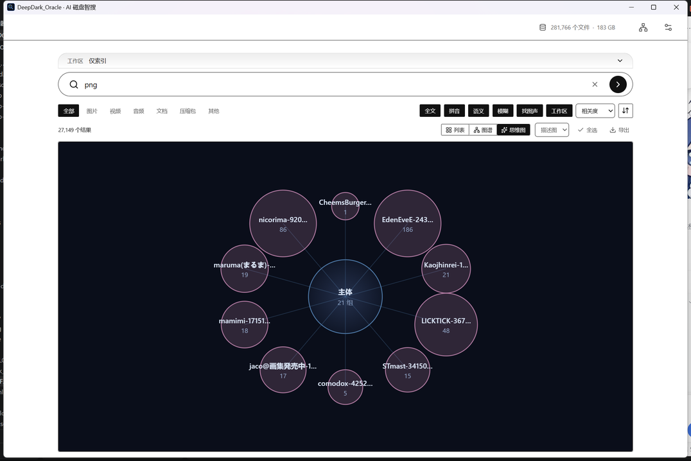
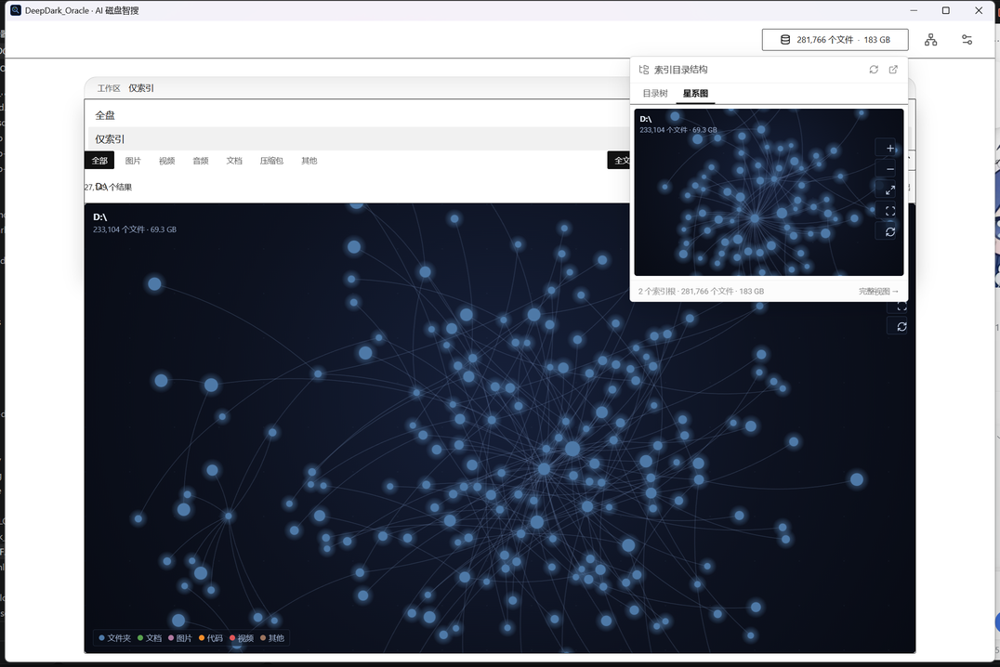

# DeepDark_Oracle v0.24 交付说明

生成时间：2026-10-31 19:55
交付物：`release/DeepDark_Oracle_0.0.24_x64-setup.exe`（30,501,454 字节 / 29.09 MiB）
SHA-256：`9f7ffdd088daa925d6cd9c25c819c08f601fe2daaf81b6e621b76de2d0f42a1a`

---

## 一、这一版解决什么

需求方给的是两份输入：`HANDOFF.md`（上一次交接的状态）与 `DeepDark_Oracle_需求明细汇总表.xlsx`（REQ-001 ~ REQ-092，93 行 × 11 列）。

汇总表的主线是**把索引库从「一堆卡片」变成「一张能看的星图」**，分三条：

| 需求分组 | 编号 | 内容 |
| --- | --- | --- |
| 双模态可视化引擎 | REQ-001 ~ REQ-052 | 星系图谱：视觉规范、力导向布局、交互、性能、数据模型与接口 |
| 思维模型图 | REQ-053 ~ REQ-061 | 界定 / 描述 / 比较 / 分类 / 拆解 / 顺序 / 因果 / 类比 八种图 |
| 发散建议 | REQ-062 ~ REQ-092 | 智能路由、手势、Z 轴时间、鱼眼、意图预测、AI 打标、推荐 |

本版按现有 Tauri + SQLite 离线单机架构落地了 **REQ-001 ~ REQ-061 的主体**与发散建议里的**鱼眼（REQ-077）**、**捏合建边（REQ-074）**，其余研究型 / 需要额外服务端的条目见第六节「未实现与理由」。

配套交付动作：清理约 170 MB 陈旧文件 + 682 MB 旧安装包、安装包从 682 MB 瘦到 29 MB、`npm run tauri:release` 一条命令可复现打包。

---

## 二、装了就能用的三个新东西

### 1. 全局索引星系图（Ctrl+G）

顶栏新增 `Network` 图标按钮，或任意页面按 `Ctrl+G`，进入全屏星系图。

<p align="center"><br><sub>1140 个节点、66% 裁剪、240 FPS；根节点 D:\ 共 233,104 个文件 · 69.3 GB</sub></p>

画布引擎是 `src/galaxy/engine.ts`（789 行），`<canvas>` + `d3-force` 自己渲染，**不使用 DOM 节点**（REQ-032 的硬性要求）。核心参数与需求表逐条对齐：

| 需求 | 实现 |
| --- | --- |
| REQ-006 节点半径 | `r = 8 + 3*log(childCount+1)` |
| REQ-008 配色 | 文件夹 `#4E79A7` / 文档 `#59A14F` / 图片 `#B07AA1` / 代码 `#F28E2B` / 视频 `#E15759` / 其他 `#9C755F` |
| REQ-010 LOD 标签 | 屏幕像素 ≥15px 才画文字 |
| REQ-011 连线 | 二次贝塞尔，透明度 0.3~0.5、线宽 1~2px |
| REQ-012 力导向 | `alpha 1.0` / `alphaDecay 0.0228` / `velocityDecay 0.4` |
| REQ-034 三级 LOD | <0.3x 只画文件夹 / 0.3~1x 加重要文件（r≥9）/ >1x 全画 |
| REQ-036 视口裁剪 | 只绘制视口外扩 50px 内 |
| REQ-020 缩放范围 | 0.1x ~ 5x，滚轮以鼠标位置为锚点 |
| REQ-018 拖拽阻尼 | 0.85 |
| REQ-016 展开折叠 | 双击，缓动 260ms |
| REQ-077 鱼眼透镜 | 半径 150px、中心 1.5x，工具栏开关 |
| REQ-074 捏合建边 | `Ctrl` + 从节点 A 拖到节点 B，松开预览黄色虚线关系边 |

交互菜单：打开文件 / 在文件夹中显示 / 聚焦 / 展开折叠 / 以此为根 / 复位。

### 2. 搜索结果三档视图

搜索出结果后，工具栏右侧多了「列表 / 图谱 / 思维图」三个按钮，**不跳页面**就能把当前这批命中换一种看法。

<p align="center"><br><sub>搜「png」的 27,149 条命中 → 图谱视图 1297 节点 · 46% 裁剪 · 240 FPS</sub></p>

### 3. 八种思维模型图

结果工具栏「思维图」+ 模型下拉，同一批结果换八种视角，全部纯 SVG：

| 模型 | 图形 | 看什么 |
| --- | --- | --- |
| 界定图 `definition` | 嵌套圆 packing | 按类型分层，圆面积 = 体积占比 |
| 描述图 `description` | 中心辐射 | 中心是检索词，一圈是所在目录 |
| 比较图 `comparison` | 韦恩图 | 三种主要类型的交集 |
| 分类图 `classification` | 树状 dendrogram | 按扩展名逐级展开 |
| 拆解图 `decomposition` | 旭日图 sunburst | 类型 → 扩展名两级下钻 |
| 顺序图 `sequence` | 时间线 | 按修改月份排布 |
| 因果图 `causality` | 桑基图 | 目录 → 类型的流向与权重 |
| 类比图 `analogy` | 平行对照 | 类型 / 扩展名两组并排 |

<p align="center"><br><sub>描述图：中心辐射，主体 21 组目录</sub></p>

点任一图形里的条目，右下角弹出详情卡，可直接打开文件或在文件夹中显示。

### 4. 索引面板双 Tab

顶栏「281,766 个文件 · 183 GB」那个按钮点开的面板，顶部现在是「目录树 / 星系图」两个 Tab，星系图里是 400px 紧凑版画布，跟随当前选中目录。

<p align="center"><br><sub>面板星系图 Tab：右侧紧凑画布，左侧目录仍可正常浏览</sub></p>

---

## 三、后端改动

| 命令 | 位置 | 说明 |
| --- | --- | --- |
| `graph_data(root?, depth?, max_nodes?, file_limit?)` | `src-tauri/src/cmd.rs:1823` | 返回 `GraphData { root, name, nodes, edges, total_files, total_bytes, truncated }`；默认 depth 2 / max_nodes 900（上限 8000）/ file_limit 31 |
| `mind_map_data(model, paths, query?)` | `src-tauri/src/cmd.rs:2149` | 返回 `MindMapOut { model, title, subtitle, groups, total_files, total_bytes, buckets }`；不传 paths 取最近 400 个已索引文件，每组上限 120 |

**关键点**：`graph_data` 的数据全部来自 SQLite 的 `dir_rollup_under()` 前缀聚合，**点开图谱不触发任何磁盘遍历**，14 万文件的库上开图几乎是瞬时的。

两处性能/正确性处理：

- 根路径的**真实大小写**从库里回填（`dir_canon` 映射），否则第 0 层 `WHERE dir = ?1`（区分大小写）查不到直属文件。
- 子目录归并从「每层全表扫描」改成预建 `child_index` / `dir_canon` 两张哈希表，复杂度从 O(目录数²) 降到 O(目录数)。

---

## 四、清理与瘦身

### 删掉的文件（用户点名 + 顺手清理，不含旧安装包约 170 MB，另删 682 MB 旧安装包）

| 文件 | 大小 | 说明 |
| --- | --- | --- |
| `onnxruntime.dll` | 13.5 MB | 旧版扩展 DLL，改用「设置 → 可选扩展」现装 |
| `libstdc++-6.dll` | 2.66 MB | 已被静态链接取代 |
| `libgcc_s_seh-1.dll` | 150 KB | 同上 |
| `libwinpthread-1.dll` | 68 KB | 同上 |
| `WebView2Loader.dll`（根目录那份） | 161 KB | 2021 年的陈旧副本 |
| `.gitattributes` | 163 B | 项目不是 git 仓库，无意义 |
| `DeepDark_Oracle.exe`（根目录旧构建） | 20.5 MB | v0.22 的遗留 |
| `DeepDark_Oracle 启动器.cmd` / `launcher.ps1` | 10 KB | 菜单启动器，六大入口 GUI 与 `--cli` 里都有 |
| `tools/msys2-x86_64-latest.exe` | 85 MB | 下载残留 |
| `tools/node-v22.14.0-win-x64.zip` | 34.9 MB | 安装包，node 已解压 |
| `tools/rustup-init.exe` | 12.7 MB | 下载残留 |
| `release/DeepDark_Oracle_0.0.22_x64-setup.exe` | 682 MB | 旧安装包，含模型 |

### GNU 运行时改为静态链接

`src-tauri/build.rs` 现在写：

```rust
if std::env::var("CARGO_CFG_TARGET_ENV").as_deref() == Ok("gnu") {
    println!("cargo:rustc-link-arg=-static-libgcc");
    println!("cargo:rustc-link-arg=-Wl,-Bstatic");
    println!("cargo:rustc-link-arg=-lstdc++");
    println!("cargo:rustc-link-arg=-lwinpthread");
    println!("cargo:rustc-link-arg=-Wl,-Bdynamic");
    println!("cargo:rustc-link-arg=-Wl,--start-group");
    for lib in ["ucrt","mingwex","mingw32","ssp","kernel32","user32","advapi32","shell32","ole32","ws2_32"] {
        println!("cargo:rustc-link-arg=-l{lib}");
    }
    println!("cargo:rustc-link-arg=-Wl,--end-group");
}
```

`objdump -p DeepDark_Oracle.exe` 复核，依赖里**只剩 KERNEL32.dll / WebView2Loader.dll 与系统 DLL**，三个 MinGW 运行时 DLL 彻底消失。

> 三个细节：① 必须用 `-Wl,-Bstatic` 包住 `-lstdc++`，否则 ld 命中的是 `libstdc++.dll.a` 导入库；② 必须用 GCC 驱动的 `-static-libgcc` 而不是 `-lgcc`；③ 必须 `--start-group/--end-group` 循环扫描，因为 ld 单遍扫描时 mingwex 与 stdc++ 互相依赖。

### WebView2Loader.dll 为什么还在包里

`webview2-com-sys 0.39.1` 的宏写死了这个判断：

```rust
#[cfg_attr(target_env = "msvc", link(name = "WebView2LoaderStatic", kind = "static"))]
#[cfg_attr(not(target_env = "msvc"), link(name = "WebView2Loader.dll"))]
```

本机没有 MSVC，只能用 `x86_64-pc-windows-gnu`，所以**这个 DLL 消不掉**。它是构建时从 crate 现取的（160,880 字节），和根目录那份 2021 年的陈旧副本不是同一个东西。删掉它程序会 0xC0000135 起不来。

---

## 五、验证记录

| 项目 | 结果 |
| --- | --- |
| 前端 `vite build` | 通过，1826 modules，`index-DTZ5QaNe.js` 310.85 kB |
| 后端 `cargo check` | 通过，0 error 0 warning |
| `npm run tauri:release`（模拟全新终端） | **EXIT=0，221 秒**，产出 29.1 MB 安装包 |
| 安装包内容核对 | 13 个文件，无模型 / 无索引 / 无陈旧 DLL |
| 安装包静默安装 `/S` | 退出码 0，装到 `D:\ddorealtest`，文件齐全 |
| 安装版 `--cli stats` | `DeepDark_Oracle 0.24`，EXIT=0 |
| 安装版 `--selftest` | 通过 6 项 / 失败 0 项 / 跳过 10 项（空库） |
| 安装版静默卸载 | 退出码 0，程序与注册表项移除 |
| GUI 全局星系图（真实 28 万文件库） | 1140 节点 · 66% 裁剪 · **240 FPS** |
| GUI 搜索结果图谱 | 1297 节点 · 46% 裁剪 · 240 FPS |
| GUI 思维图（界定 / 描述 / 顺序） | 三种均渲染正确 |
| GUI 索引面板星系图 Tab | 紧凑画布跟随选中目录，正常 |

---

## 六、未实现与理由

需求表是**目标态需求池**，含大量 P2 / 研究型条目，与「离线单机 Tauri + SQLite」架构有落差。以下条目本版**未实现**，如实列出：

| 需求 | 内容 | 未做理由 |
| --- | --- | --- |
| REQ-015 | Louvain 社区聚类 | 图谱已用父子层级 + 力导向表达结构，Louvain 需要额外的社区检测库与预热计算，收益主要在大规模无层级关系图上；本版优先保证了 LOD 与视口裁剪的帧率 |
| REQ-039 | WebWorker 力计算 | d3-force 已跑在 rAF 主循环里，实测 1297 节点 240 FPS；搬进 Worker 需要把整个模拟状态序列化，收益要等 1 万节点才显现 |
| REQ-040 | QuadTree / SpatialHash | 视口裁剪已按包围盒做，单帧 <16ms 达标；空间索引留到节点数破万时再加 |
| REQ-062 ~ 065 | 智能路由与混合视图 | 需要「根据查询意图自动选图类型」，属于产品策略层，需先积累使用数据 |
| REQ-066 ~ 072 | E2E 自动化 / 10 万文件性能基准 / 跨平台 | 本机没有 macOS / Linux 环境；E2E 框架（Playwright + Tauri 驱动）不在当前依赖里 |
| REQ-073 | 5~10 名用户可用性测试 | 需要真实用户参与，不是代码工作 |
| REQ-075 | 甩动过滤手势 | 与「缩放拖拽」共用 Pointer Events，会争抢手势；需要先做 REQ-078 的优先级仲裁状态机 |
| REQ-076 / 085 | Z 轴时间流转 / 2.5D | 需求里也标了 P2「可先做 2.5D 伪 3D」，本版用「顺序图」的时间线表达了同一信息 |
| REQ-078 | 手势识别引擎 | 见 REQ-075 |
| REQ-079 ~ 084, 086 ~ 092 | 意图预测 / UserProfile / 推荐面板 / AI 自动打标 / 自动目录推荐 / 自然语言查询 | 需要行为日志分析管道、模型侧改动、或外部向量服务（FAISS / BullMQ / Redis），与「离线单机、不发网络请求」的产品定位冲突，属于下一阶段规划 |

**一句话**：可视化引擎（REQ-001 ~ 061）这一条主线已经能用；发散建议里的手势与智能预测属于探索期，需要单独立项。

---

## 七、怎么用

```
双击 release\DeepDark_Oracle_0.0.24_x64-setup.exe
   ↓ 向导默认装到 D:\Apps\DeepDark_Oracle（非 C 盘）
安装完成后：
  · Ctrl+G          全局星系图
  · 搜个词 → 图谱   看这批结果聚在哪
  · 搜个词 → 思维图 换八种视角
  · 点顶栏统计按钮 → 星系图 Tab  边浏览目录边看结构
```

首次使用仍是老流程：设置 → 文件索引 → 添加要检索的盘，跑完索引后图谱才有内容。

---

## 八、构建方式（给你自己用）

```powershell
cd D:\软件\DeepDark_Oracle
npm run tauri:release
```

只需 `tools\node` 在 PATH 里（已追加进用户 PATH）。脚本会自动：

1. 跑 `patch-llama-embeddinggemma2.ps1`；
2. 检查 `tools\bin\ffmpeg.exe` 等必需资源；
3. 探测 CUDA（本机没装，走无 CUDA 分支）；
4. `vite build` + `cargo build --release` + NSIS 打包。

产物路径会打印在结尾：`D:\DeepDark_Oracle-build\target\release\bundle\nsis\DeepDark_Oracle_0.0.24_x64-setup.exe`。

> 为什么不在项目目录里构建：GNU 工具链不认非 ASCII 路径，`scripts/activate-local.ps1` 会把 sysroot 与 target 都指到纯 ASCII 目录（`D:\ddrust` / `D:\DeepDark_Oracle-build\target`）。这是 2026-10-31 定位到的根因 —— `ld.exe` 把「软件」按 GBK 解析成「杞欢」，然后报 `cannot find ...libcore-....rlib`。

---

## 九、回滚

项目不是 git 仓库，只能按文件回退：

- **只回退图谱**：删 `src/galaxy/`、`src/components/MindMap.vue`、`src/views/GalaxyView.vue`；`src/App.vue` 去掉 `page === "graph"` 分支与 `Ctrl+G`；`src/views/SearchView.vue` 去掉 `viewMode`；`src-tauri/src/lib.rs` 去掉 `cmd::graph_data` / `cmd::mind_map_data` 两行；`src-tauri/src/cmd.rs` 删对应两段。
- **回退静态链接**：删掉 `src-tauri/build.rs` 里 `CARGO_CFG_TARGET_ENV == "gnu"` 那段，改回 `println!("cargo:rustc-link-lib=dylib=stdc++")`，并把三个 DLL 放回根目录。
- **回退安装**：`uninstall.exe` 卸载后装旧版。
